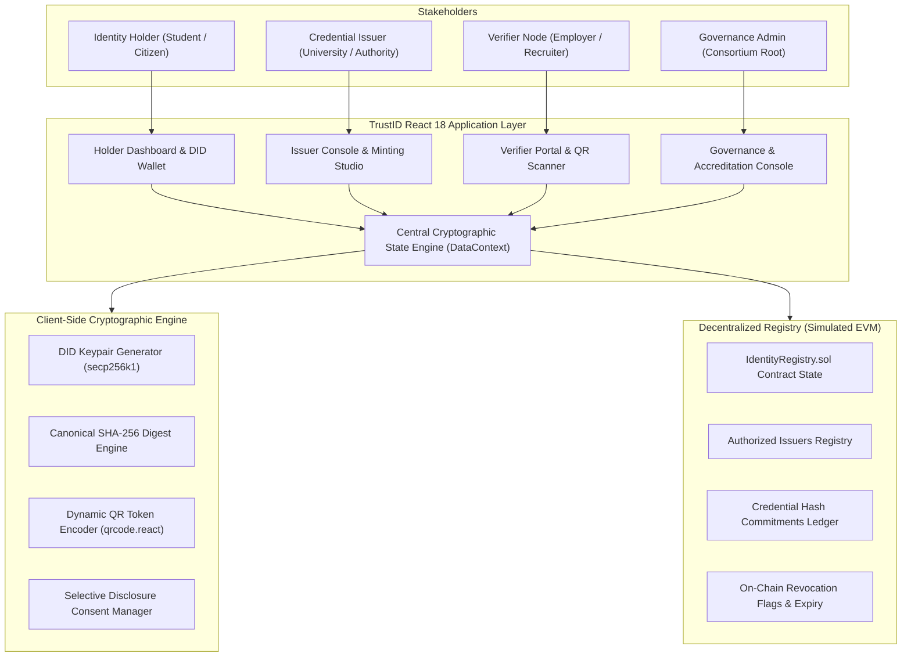
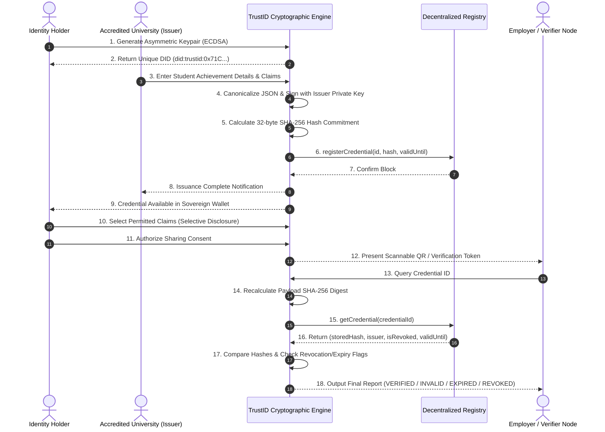
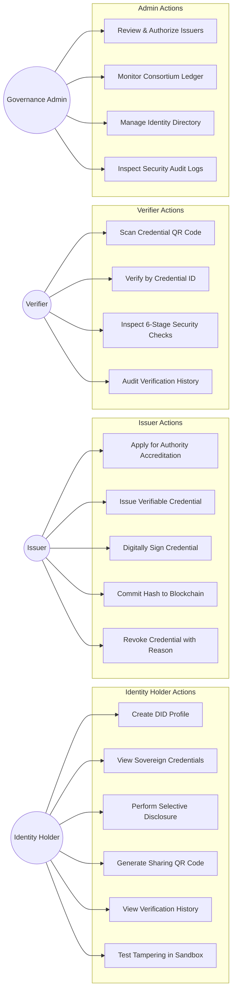
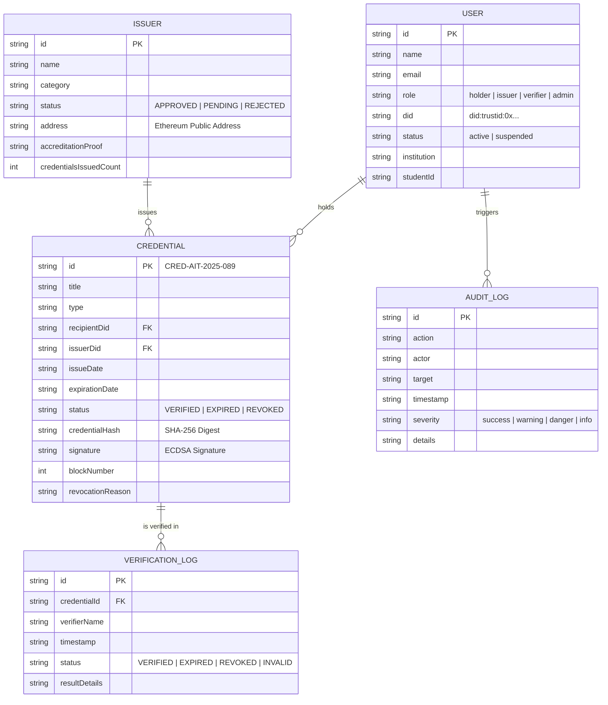

# TrustID — System Architecture & Diagram Sources

This document contains architectural diagrams and specification sources for the **Blockchain-Based Digital Identity Management System**.

---

## 1. High-Level System Architecture Diagram



---

## 2. End-to-End Credential Issuance & Verification Sequence Diagram



---

## 3. Use Case Diagram



---

## 4. Data Flow Diagram (DFD Level 1)

```mermaid
graph TD
    P1["1.0 DID Generation"]
    P2["2.0 Credential Canonicalization & Signing"]
    P3["3.0 Blockchain Commitment Registration"]
    P4["4.0 Selective Presentation & QR Encoding"]
    P5["5.0 Multi-Stage Verification Pipeline"]

    D1[("Off-Chain Sovereign Store")]
    D2[("Smart Contract Registry")]
    D3[("Verification Audit Log")]

    U1["Identity Holder"] -->|Registration Info| P1
    P1 -->|Store DID Profile| D1

    U2["Issuer Authority"] -->|Student Claims Data| P2
    P2 -->|Signed Canonical JSON| D1
    P2 -->|32-byte Digest & Validity| P3
    P3 -->|registerCredential()| D2

    U1 -->|Consent & Claim Selection| P4
    D1 -->|Read Selected Claims| P4
    P4 -->|Verification Token URL / QR| U3["Verifier Node"]

    U3 -->|Scan QR / Enter ID| P5
    P5 -->|Read Stored Hash & Revocation State| D2
    P5 -->|Write Verification Log Entry| D3
    P5 -->|Display Result Report| U3
```

---

## 5. Entity Relationship (ER) Data Model


